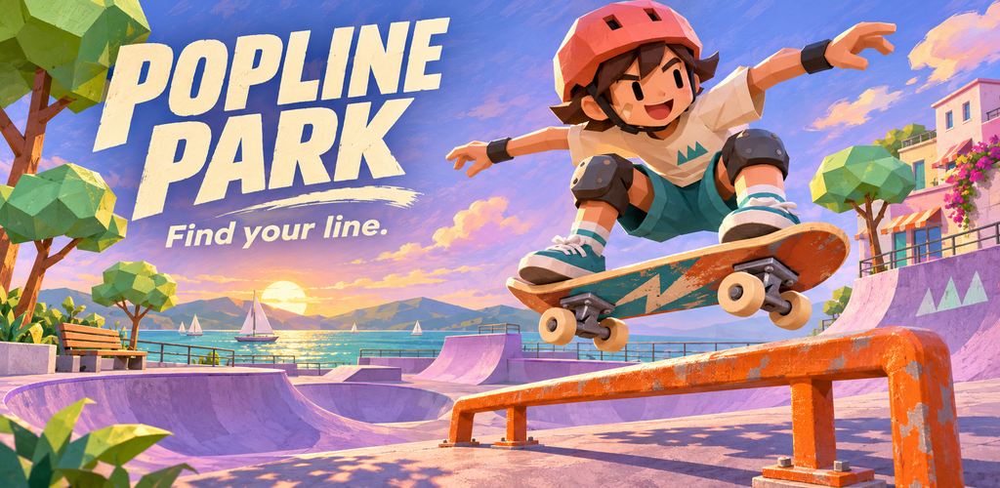

# Popline Park

**Find your line.** A portrait skateboarding arcade game made with Godot 4.5.1 Compatibility. Steer between three lanes, ollie onto rails, dodge low blocks and build a cleaner combo.



30 short campaign lines, three district palettes, Endless Ride, a seeded daily line, daily goals, a seven-day gift streak, two skaters and capped gear upgrades. Versioned local saves, 20 achievements and three record categories work offline. Android AdMob and Play Games integrations use sample/disabled configuration until publisher setup.

Touch: swipe left/right and tap to ollie, or use the large on-screen buttons. Keyboard: arrows/A–D and Space. Pause before leaving a ride; backgrounding also pauses and saves. A saved ride resumes until completed or explicitly ended and banked.

## Run and build

Open `project.godot` with **Godot 4.5.1**, using Compatibility. No Windows distribution is produced. Development editor runs are supported.

```sh
godot --headless --editor --path . --import
godot --headless --path . --export-release Web build/web/index.html
godot --headless --path . --install-android-build-template
godot --headless --path . --export-debug Android build/android/popline-park-debug.aab
```

Create output directories first. Android uses the installed SDK, Java 17 and matching Godot templates. The default Android preset is AAB, target API 36, min API 24, ARM64 + x86 + x86_64, and `runnable=false` to avoid editor-exit ADB interference. `Android Test APK` is the separate installable test preset. Production signing remains external.

```sh
python tools/verify_android_bundle.py build/android/popline-park-debug.aab
```

Tests must use fresh isolated user-data roots. On Linux set `XDG_DATA_HOME` and `POPLINE_TEST_ROOT` to the same new directory; on Windows set process `APPDATA`, `LOCALAPPDATA` and `POPLINE_TEST_ROOT`. Then run:

```sh
godot --headless --path . --script tests/test_rules.gd
godot --headless --path . --script tests/test_ui_flows.gd
```

Use a different empty root for each test run. Tests never reset genuine player data. `tests/capture_runtime.gd -- phone` (or `tablet7`, `tablet10`) drives a real rendered fresh-profile ride and saves genuine viewport images. It is automated desktop evidence, not physical-device playtesting.

## Review and publishing package

- [Visual review](review/index.html)
- [Build-bound acceptance and limitations](docs/ACCEPTANCE.md)
- [Android service setup](docs/PLATFORM_SETUP.md)
- [Design, assets and market comparison](docs/DESIGN_AND_ASSETS.md)
- [Iteration record](docs/BUG_LOG.md)
- Store copy, 512px app icon, 1024×500 feature graphic, portrait splash, 20 achievement icons, three leaderboard icons and profile-specific screenshots live under `marketing/`.

The Web edition keeps local progress and displays honest Android-service fallbacks. Clearing browser site data removes its save. The Android build uses Google sample ads; production services and physical-device acceptance are not claimed.

Original code and music: Apache 2.0. Kenney assets: CC0. Godot/plugins: MIT and their bundled notices. Illustrated branding and badges: AI-generated artwork for this project. See [NOTICE](NOTICE) and [license index](LICENSES/INDEX.txt).
